# Database schema

The tables in the Supabase Postgres database, as the files in [`supabase/migrations/`](../supabase/migrations/) leave them after the last migration. A table that a later migration removed is not shown. Each box lists the table's keys and its main columns. `PK` marks the columns that identify a row, and `FK` marks the columns that point to a row in another table.

```mermaid
erDiagram
    auth_users ||--|| profiles : "has one"

    surah ||--o{ verse : contains
    verse ||--o{ word : contains
    verse ||--o{ verse_transliteration : "pronounced as"
    verse ||--o{ span : "starts or ends"
    word |o--o{ span : "starts or ends at"

    source ||--o{ passage : contains
    verse |o--o{ passage : "found at, for books ordered by verse"

    span ||--o{ explanation : "explained by"
    explanation ||--o{ explanation_item : "made of points"
    explanation_item ||--o{ explanation_item_citation : cites
    passage ||--o{ explanation_item_citation : "cited by"
    explanation ||--o{ explanation_citation : cites
    passage ||--o{ explanation_citation : "cited by"
    explanation ||--o{ context_link : "points to"
    span ||--o{ context_link : "linked text"

    surah ||--o{ reading_section : "read in"
    span ||--o{ reading_section : covers
    explanation ||--o| reading_section : "explains"

    surah ||--o| surah_brief : "introduced by"
    surah_brief ||--o{ surah_brief_item : "made of paragraphs"
    surah_brief_item ||--o{ surah_brief_item_citation : cites
    passage ||--o{ surah_brief_item_citation : "cited by"

    word ||--o| word_meaning : "means"
    word_meaning ||--o{ word_meaning_citation : cites
    passage ||--o{ word_meaning_citation : "cited by"
    word_meaning ||--o{ word_meaning_elsewhere : "used elsewhere"

    span ||--o{ qa_question : "asked about"
    qa_question ||--o{ qa_question_citation : cites
    passage ||--o{ qa_question_citation : "cited by"

    explanation ||--o{ explanation_review : "review steps"
    surah_brief ||--o{ surah_brief_review : "review steps"
    word_meaning ||--o{ word_meaning_review : "review steps"
    verse_transliteration ||--o{ verse_transliteration_review : "review steps"
    qa_question ||--o{ qa_question_review : "review steps"

    auth_users {
        uuid id PK
        text email
    }
    profiles {
        uuid id PK, FK
        text language_pref "en or ko"
        timestamptz created_at
    }
    surah {
        smallint number PK "1 to 114"
        text name_ar
        text name_en
        text name_ko
        enum revelation_place "meccan or medinan"
        smallint verse_count
        text basmala_ar
    }
    verse {
        smallint surah PK, FK
        smallint ayah PK
        text text_ar "from Tanzil"
    }
    word {
        smallint surah PK, FK
        smallint ayah PK, FK
        smallint position PK
        text text_ar
        text root
    }
    verse_transliteration {
        smallint surah PK, FK
        smallint ayah PK, FK
        text language PK "en or ko"
        text text
        enum status
    }
    span {
        text id PK
        smallint start_surah FK
        smallint start_ayah FK
        smallint start_word FK "empty means whole verse"
        smallint end_surah FK
        smallint end_ayah FK
        smallint end_word FK "empty means whole verse"
    }
    source {
        text id PK
        text title_ar
        text title_en
        text author
        text edition
        enum type "tafsir, asbab_al_nuzul, word_dictionary, hadith, modern_study"
    }
    passage {
        text id PK
        text source_id FK
        text volume
        text page
        smallint verse_surah FK
        smallint verse_ayah FK
        text url "where to open it, such as Shamela"
    }
    explanation {
        text id PK
        text span_id FK
        enum kind "phrase_note, verse_explanation, reading_section"
        enum status
    }
    explanation_item {
        text explanation_id PK, FK
        enum part PK "word_meanings, background, context, connected_verses"
        smallint sort_order PK
        text text_en
        text text_ko
        smallint verse_surah "related verse, no FK"
        smallint verse_ayah "related verse, no FK"
    }
    explanation_item_citation {
        text explanation_id PK, FK
        enum part PK, FK
        smallint item_order PK, FK
        smallint sort_order PK
        text passage_id FK
        text quoting "who the passage quotes"
    }
    explanation_citation {
        text explanation_id PK, FK
        text passage_id PK, FK
        smallint sort_order
    }
    context_link {
        text explanation_id PK, FK
        smallint sort_order PK
        text span_id FK
        text reason_en
        text reason_ko
    }
    reading_section {
        smallint surah PK, FK
        smallint position PK
        text span_id FK
        text explanation_id FK "one section per explanation"
    }
    surah_brief {
        smallint surah PK, FK
        enum status
    }
    surah_brief_item {
        smallint surah PK, FK
        smallint sort_order PK
        text text_en
        text text_ko
    }
    surah_brief_item_citation {
        smallint surah PK, FK
        smallint item_order PK, FK
        smallint sort_order PK
        text passage_id FK
        text quoting
    }
    word_meaning {
        smallint surah PK, FK
        smallint ayah PK, FK
        smallint position PK, FK
        text meaning_en
        text meaning_ko
        enum status
    }
    word_meaning_citation {
        smallint surah PK, FK
        smallint ayah PK, FK
        smallint position PK, FK
        text passage_id PK, FK
        smallint sort_order
        text quoting
    }
    word_meaning_elsewhere {
        smallint surah PK, FK
        smallint ayah PK, FK
        smallint position PK, FK
        smallint sort_order PK
        smallint verse_surah "other verse, no FK"
        smallint verse_ayah "other verse, no FK"
        text text_en
        text text_ko
    }
    qa_question {
        text id PK
        text span_id FK
        smallint sort_order
        text question_en
        text question_ko
        text answer_en
        text answer_ko
        enum status
    }
    qa_question_citation {
        text question_id PK, FK
        smallint sort_order PK
        text passage_id FK
        text quoting
    }
    explanation_review {
        text explanation_id PK, FK
        smallint step PK
        enum status
        text reviewer
        date reviewed_on
        text notes
    }
    surah_brief_review {
        smallint surah PK, FK
        smallint step PK
        enum status
        text reviewer
        date reviewed_on
    }
    word_meaning_review {
        smallint surah PK, FK
        smallint ayah PK, FK
        smallint position PK, FK
        smallint step PK
        enum status
        text reviewer
        date reviewed_on
    }
    verse_transliteration_review {
        smallint surah PK, FK
        smallint ayah PK, FK
        text language PK, FK
        smallint step PK
        enum status
        text reviewer
        date reviewed_on
    }
    qa_question_review {
        text question_id PK, FK
        smallint step PK
        enum status
        text reviewer
        date reviewed_on
    }
```

`auth_users` is the user table that Supabase's sign-in service manages (`auth.users`). Every table in the app's own part of the database has row level security turned on: the database itself decides which rows a visitor may read, whatever the website asks for. No reader can write to any content table.

## What each group of tables is for

**Accounts: `profiles`.** Supabase keeps the email address and password. The app keeps one `profiles` row per user, created automatically at sign-up, which holds the language they chose. A user can read and change only their own row.

**Quran text: `surah`, `verse`, `word`.** The Arabic text exactly as the Tanzil Project publishes it, imported by a script and never edited by hand. Verse numbers follow the Hafs mushaf, and pause marks are not counted as words. Anyone can read these tables.

**Places in the text: `span`.** A span is a stretch of the text, from one word or verse to another. It can be a phrase, a whole verse, or several verses. Explanations, reading sections and questions all attach to a span rather than to a verse number, so a note can cover exactly the words it is about.

**Sources: `source`, `passage`.** A source is a book, such as a tafsir or a hadith collection. A passage is the place in that book an explanation cites: a volume and page, or a verse for books arranged by verse, plus a link (usually to Shamela) where a reader can open it. The list of books is public. A passage becomes readable once something published cites it.

**Explanations and reading sections: `explanation`, `explanation_item`, `explanation_item_citation`, `explanation_citation`, `context_link`, `reading_section`.** A surah is read in sections, in order, and each section has one explanation. An explanation is made of points in four parts (word meanings, background, context, connected verses), and each point lists the passages that support it, so readers see which book backs which point. Where the sections start and end is public, so the page can show a section whose explanation is still in review as "coming soon". `explanation_citation` lists every passage an explanation's points cite, all in one place, and the seed fills it from the points. `context_link` points from an explanation to other text a reader needs to understand it, with the reason; no explanation written so far uses one.

**Surah introduction: `surah_brief`, `surah_brief_item`, `surah_brief_item_citation`.** The short introduction at the top of a surah page, as a list of paragraphs, each with its own citations.

**Word meanings: `word_meaning`, `word_meaning_citation`, `word_meaning_elsewhere`.** What a word means in its own verse, the passages that support it, and notes on how the same word is used in other verses. These fill the popup that opens when a reader taps an underlined word.

**Pronunciation: `verse_transliteration`.** How each verse sounds, in Latin letters for English pages and in Hangul for Korean pages. Each language is written and reviewed on its own.

**Fixed questions: `qa_question`, `qa_question_citation`.** Prepared questions for each reading section, with English and Korean answers and their sources. They are written and reviewed like explanations; they are not generated by AI.

**Review history: the five tables ending in `_review`.** Every content row above with a `status` moves through the same review steps, one at a time: draft, English approved, Korean drafted, Korean approved, published (pronunciation has a shorter track per language). These tables record each step: who approved it, when, and any notes. They are private: no visitor can read them. Readers only ever see rows whose status is published.

## How content gets into the database

Content is written as JSON files in [`content/`](../content/README.md) and kept in git. A script sends all of it to one database function, `seed_content`, which runs with the service role key and replaces the content tables in a single step. The website never writes content. The decision records [content in git, seeded into Supabase](decisions/0011-content-in-git-seeded-into-supabase.md) and [explanations attach to spans](decisions/0012-explanations-attach-to-spans.md) explain why.
