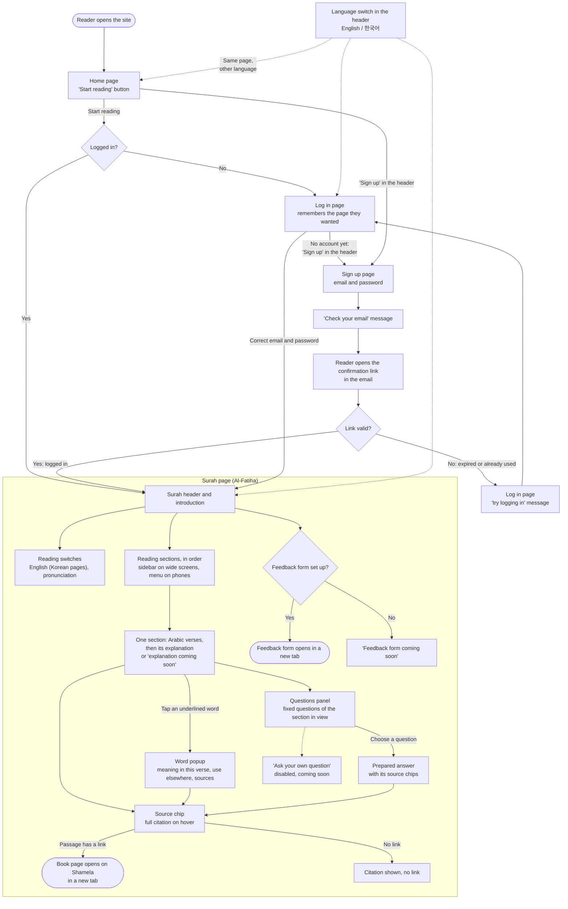

# User flow

How a reader moves through the site in Sprint 1. Every page exists in English (`/en/…`) and Korean (`/ko/…`). Opening the site without a language goes to English.

## The steps in words

1. **Home page.** The reader lands on the home page, which introduces the site and has a "Start reading" button that goes to the first surah. A reader who isn't logged in also sees a note that reading needs an account.
2. **Log in first.** The surah pages are for logged-in readers only. A reader who isn't logged in is sent to the log in page, which remembers where they were going and sends them back there afterwards.
3. **Sign up and confirm the email.** A new reader uses the "Sign up" link in the header, on any page, and signs up with an email and a password. Like the log in page, sign up remembers the page they came from. The site then asks them to check their email. The link in that email confirms the address, logs them in and takes them to the page they wanted. If the link has expired or was already used, they land on the log in page with a message that their address may already be confirmed and they can try logging in.
4. **Surah page.** The page opens with the surah's name and a short introduction. Switches show or hide the English text (on Korean pages; English pages always show it) and the pronunciation. The reader's choices are remembered in the browser.
5. **Reading sections.** The surah is split into sections read in order. The sidebar (a menu on phones) lists them and highlights the one on screen. Each section shows its Arabic verses and then its explanation. A section whose explanation is still in review says "explanation coming soon".
6. **Word popup.** Words with a meaning are underlined. Tapping or clicking one opens a small popup with what the word means in this verse, how it is used elsewhere, and the sources.
7. **Source chips.** Every point of an explanation, every word meaning and every answer ends with small "Source" chips. Hovering one shows the full citation: the book, the volume and the pages. Clicking it opens that page of the book on Shamela, an online library of Islamic books, in a new tab. A passage without a link is cited without one.
8. **Fixed questions.** The questions panel lists the prepared questions for the section on screen (on phones they appear under each section). Choosing a question opens its answer and the sources behind it. These answers are written and reviewed like the explanations. The box for asking your own question is shown, but turned off and marked "coming soon", until the AI service arrives in Sprint 2.
9. **Language switch.** The header on every page has an English / 한국어 switch. It opens the same page in the other language, so a reader can compare the two.
10. **Feedback form.** During user testing, the surah page has a button that opens the feedback form in a new tab (at the end of the page on phones). If no form has been set up for the site, the button says the form is coming soon.
